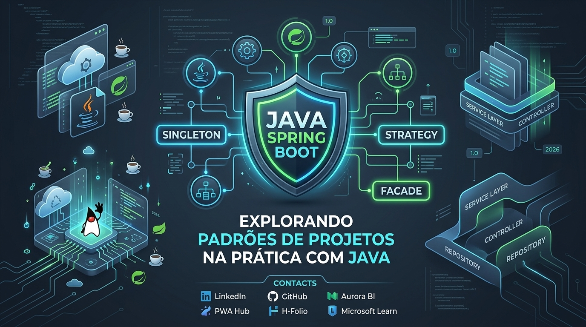

<div align="center">



# ☕ Explorando Padrões de Projeto na Prática com Java & Spring Boot


[](https://github.com/Rafael-TOZATO/lab-padroes-projeto-spring)
[](https://github.com/Rafael-TOZATO/lab-padroes-projeto-spring)
[](https://github.com/Rafael-TOZATO)

</div>

---

## 📌 Sobre o Projeto

Este repositório contém a implementação prática de **Padrões de Projeto (Design Patterns)** consagrados pela **GoF (Gang of Four)**, abstraídos e otimizados com o ecossistema do **Spring Framework / Spring Boot**[cite: 6, 9].

O objetivo deste laboratório é demonstrar como substituir acoplamentos rígidos e estruturas verbosas por soluções elegantes, modularizadas e mantidas via Injeção de Dependência e Inversão de Controle (IoC/DI)[cite: 9].

---

## 🏛️ Padrões de Projeto Implementados

| Padrão | Categoria | Descrição / Aplicação |
| :--- | :--- | :--- |
| 🧩 **Singleton** | Criacional | Permite a criação de instâncias únicas gerenciadas diretamente pelo container do Spring (beans gerenciados pelo `@Component` / `@Service`)[cite: 6, 9]. |
| 🎯 **Strategy** | Comportamental | Simplifica variações de algoritmos e regras de negócio definindo interfaces coesas (`Repository`, `Service` interfaces)[cite: 6, 9]. |
| 🏛️ **Facade** | Estrutural | Prove uma interface unificada para um conjunto de interfaces num subsistema, encapsulando chamadas externas complexas (ex: integração com OpenFeign / ViaCEP)[cite: 6, 9]. |

---

## 🛠️ Tecno-Stack e Ferramentas

- **Linguagem:** Java 17+ / OpenJDK[cite: 6, 7]
- **Framework Principal:** Spring Boot 3.x / Spring Data JPA / OpenFeign
- **Gerenciador de Dependências:** Apache Maven[cite: 7, 9]
- **Banco de Dados (In-Memory):** H2 Database
- **Estilo Arquitetural:** REST API / MVC Layered Architecture

---

## 🔒 Selos de Qualidade e Segurança

- **Injeção de Dependência Segura:** Utilização preferencial de construtores imutáveis em vez de `@Autowired` em campos.
- **Análise Estática:** Projeto compatível com validações CodeQL e SonarCloud[cite: 9].
- **Gerenciamento de Segredos:** Sem credenciais hardcoded nos arquivos de configuração (`application.properties`).

---

## 🌿 Estrutura de Branches e Workflow (Git)

O projeto segue uma convenção de GitFlow simplificado e seguro para evolução contínua:

- **`main`:** Branch estável e em produção com código testado e aprovado[cite: 7, 9, 10].
- **`develop`:** Branch principal de integração técnica para novas funcionalidades.
- **`feature/nome-da-feature`:** Branches secundárias para implementação isolada de novos padrões e endpoints.
- **`fix/descricao-do-bug`:** Branches de correção pontual.

---

## 🚀 Como Executar o Projeto Localmente

1. **Clonar o repositório:**
   ```bash
   git c./mvnw spring-boot:runlone [https://github.com/Rafael-TOZATO/lab-padroes-projeto-spring.git](https://github.com/Rafael-TOZATO/lab-padroes-projeto-spring.git)

2. **Navegar até a pasta do projeto:**
cd lab-padroes-projeto-spring

3. **Executar com o Maven Wrapper:**
./mvnw spring-boot:run


4. **Acessar a API:**
A aplicação estará rodando em http://localhost:8080

---

## 📬 Contatos

- 💼 **LinkedIn:** [rafaeltozato81](https://www.linkedin.com/in/rafaeltozato81)
- 🐙 **GitHub:** [Rafael-TOZATO](https://github.com/Rafael-TOZATO)
- ✍️ **Medium:** [@ornelas.tozato](https://medium.com/@ornelas.tozato)
- 🌐 **Portfólio PWA (Dev Hub):** [tozato-dev-hub.vercel.app](https://tozato-dev-hub.vercel.app)
- 🌐 **H-Folio:** [h-folio-psi.vercel.app](https://h-folio-psi.vercel.app)
- 🚀 **Aurora BI (Lovable):** [aurora-bi-dio.lovable.app](https://aurora-bi-dio.lovable.app)
- 📜 **Microsoft Learn:** [Transcript](https://learn.microsoft.com/pt-br/users/rafaelornelastozato-2209/transcript/dzo2wizrzkx2853)
